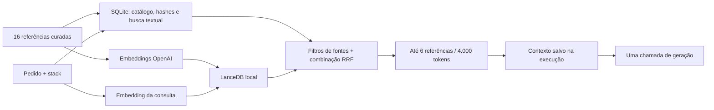

# RAG do DevKiller — versão 0.12

O RAG recupera pequenas referências técnicas antes de gerar ou corrigir um aplicativo. Ele não treina o modelo e não transforma o DevKiller em um gerador comercial de RAGs. O objetivo desta etapa é testar se referências escolhidas melhoram o resultado do próprio DevKiller.

## Usar e voltar atrás

Em **Generate app → Knowledge**, selecione um modo e pressione **Save mode**. A escolha vale para novas gerações e correções. Uma execução já salva conserva seu modo e contexto para permitir auditoria e retomada.

Instalações novas começam em **Off**. A ativação depende do benefício observado; a presença de um índice pronto não altera sozinha essa escolha.

| Modo | Comportamento | Chamadas adicionais |
| --- | --- | --- |
| Off | Entrada original da geração, sem referências | Nenhuma |
| Text retrieval | Busca local SQLite FTS5/BM25 | Nenhuma de embeddings; referências aumentam a entrada da geração |
| Hybrid retrieval | Combina ranking textual e vetorial por RRF | Uma de embeddings por consulta não presente no cache; referências aumentam a entrada da geração |

**Build semantic index** cria o índice vetorial usando a conexão OpenAI salva. Sem índice válido, o modo híbrido indica **Text fallback**: não se apresenta uma busca textual como se fosse semântica. Falha do provedor também produz fallback explícito; cancelamento interrompe a operação. A busca de prévia é explícita e pode consumir embeddings quando o modo híbrido está selecionado.

**Inspect used context** mostra o material efetivamente registrado para a última geração ou correção. É possível consultar uma pergunta de exemplo, inspecionar origem e hash e desativar fontes individualmente. Desativar uma fonte impede novas recuperações; não apaga referências do histórico. Uma geração pausada que ainda não chamou o modelo não pode usar uma referência que foi desativada ou alterada: é necessário começar uma nova execução.

Para reverter o efeito sobre o gerador, escolha **Off** e salve. Nenhum projeto precisa ser apagado. Para reverter o código inteiro, encerre o painel e use uma cópia separada do pacote 0.11.0 preservado no diretório superior; não sobrescreva bancos ou credenciais. A avaliação da versão 0.12 e a decisão de ativação estão em [VALIDATION-0.12.md](VALIDATION-0.12.md).

## Caminho dos dados

- Catálogo e índice: `settings/<porta>/knowledge/`. SQLite armazena documentos, FTS5, vetores em cache e um registro das operações de embeddings. LanceDB armazena vetores locais.
- Embeddings: `text-embedding-3-small`, 512 dimensões, endpoint fixo HTTPS da OpenAI, timeout de 30 segundos e nenhuma repetição automática. O gerador continua usando o modelo selecionado em Connections.
- Busca vetorial exata por distância cosseno: apropriada à base pequena atual. Não há índice ANN, reranker pago, GraphRAG ou serviço Python adicional.
- Cada busca aplica a stack e as fontes habilitadas antes de limitar os candidatos. Combina até 20 candidatos por ramo, com RRF de pesos iguais e constante 60. Semântico exige similaridade mínima 0,35; um resultado exclusivamente semântico exige 0,50. Esses limiares são heurísticas, não probabilidades de acerto.
- Limite de seis referências e 4.000 tokens medidos com `cl100k_base` no objeto de referências serializado. A contagem do modelo gerador pode diferir; o envelope e as instruções também consomem tokens. A consulta semântica é truncada a 2.000 tokens, dentro do limite de 8.000 caracteres do pedido.
- O contexto inclui conteúdo, origem, identificador, hash, ranking, versão do índice, modo efetivo e uso reportado. É salvo antes da reserva da chamada de geração. Uma retomada com contexto salvo não faz outra busca; uma resposta já salva não é gerada outra vez.
- Referências entram como dados delimitados na entrada. As instruções do contrato de geração e o pedido têm precedência. Isso reduz confusão de contexto, mas não é prova de imunidade a injeção de prompt.

## Curadoria e atualização

`knowledge/recipes.json` contém 16 notas técnicas curtas, revisáveis, sobre persistência, CRUD, centavos, filtros, eventos React, hooks, validação, texto literal, datas, gráficos, estoque, regressões e limites do runtime. São notas curadas nesta implementação, não exemplos de aplicativos promovidos como se tivessem sido aprovados em produção.

Não há ingestão automática de projetos, arquivos pessoais, PDFs, segredos, conversas ou casos de avaliação. O conteúdo da base e os pedidos consultados são enviados à OpenAI para embeddings quando essa operação é acionada. Os vetores ficam neste PC; portanto, índice local não significa processamento inteiramente local.

Para atualizar a base, edite o manifesto, reinicie o painel e reconstrua o índice. A validação aceita até 200 documentos pequenos e stacks conhecidas. Hashes invalidam um índice antigo quando o conteúdo muda. Fontes desativadas e o modo salvo sobrevivem à atualização. Embeddings inalterados são reutilizados. O novo índice só fica ativo após ser criado completamente; se uma reconstrução falhar, o índice completo anterior é conservado quando compatível com o catálogo atual. Tabelas antigas permanecem no disco nesta versão: não há coleta automática nem promessa de volume ilimitado.

## Custos e limites

Há três parcelas: embeddings dos documentos alterados, embeddings das consultas sem cache e entrada adicional do gerador. Não há reranker LLM nem segunda chamada de geração automática. O painel registra chamadas e tokens de embeddings separadamente; eles não representam saldo, dinheiro gasto ou limite da conta. Uma operação interrompida pode ter sido cobrada mesmo sem uso confirmado. Credencial inválida rejeitada localmente não conta como chamada ao provedor.

O cache persistente dos documentos evita repetir embeddings na reconstrução. O cache das últimas 100 consultas é em memória e se perde no reinício. O contexto durável da execução é o que evita repetir a consulta ao retomar uma geração já contextualizada. Não há promessa de recuperação sem cobrança se o processo morrer durante uma chamada antes de salvar o resultado.

Esta versão é local e individual. Não oferece ingestão de clientes, isolamento entre organizações, sincronização de conectores, ACL documental corporativa, OCR, publicação de chatbot ou faturamento. Busca pode devolver referências irrelevantes ou omitir as importantes; a avaliação mede esse risco. Não se usa a nota de similaridade como certificado de correção de um aplicativo.

## Verificação

- `npm test`: testes do runtime, coordenador, contratos, armazenamento, embeddings, busca e HTTP; não usa API real.
- Testes Playwright existentes e novos verificam interface e falhas de processo com respostas simuladas, separados do julgamento da qualidade do modelo.
- `node tests/live-rag-validation.mjs --run`: piloto pago, limitado a 12 gerações e quatro correções. Usa a conexão salva na porta 4310 em uma instância isolada; não tenta novamente falhas. O código gerado e as evidências são preservados, mas a instância temporária e sua cópia cifrada da credencial são removidas.
- `node tests/live-rag-recheck.mjs <pasta-do-estudo>`: reexecuta os mesmos arquivos com banco limpo, confirma exclusões na interface e aguarda o resultado de controles assíncronos, sem gerar novamente e sem embeddings. Preserva os resultados originais. A política do preview permanece igual; um diálogo nativo bloqueado por ela continua bloqueado.

O conjunto de avaliação não é indexado. Alterar receitas ou limiares com base nos erros desse conjunto exige outro conjunto de teste para validar a mudança. A aprovação da infraestrutura e o benefício do RAG sobre a qualidade do aplicativo são conclusões distintas.

## React Studio expansion — 0.13

Seven authored S01–S07 guides supplement the earlier catalog. AnythingLLM now has 60 registered documents; the alternative local catalog has 30 recipes. Complete Studio recipes are hash-verified before inclusion. New-profile eligibility is explicit; old package contracts and the old menu implementation remain scoped to old profiles. RAG still has at most six references and 4,000 tokens, and remains data rather than privileged instructions. Evidence: `validation/studio-v1/retrieval.json`; eight real searches, simulated generation transport.
